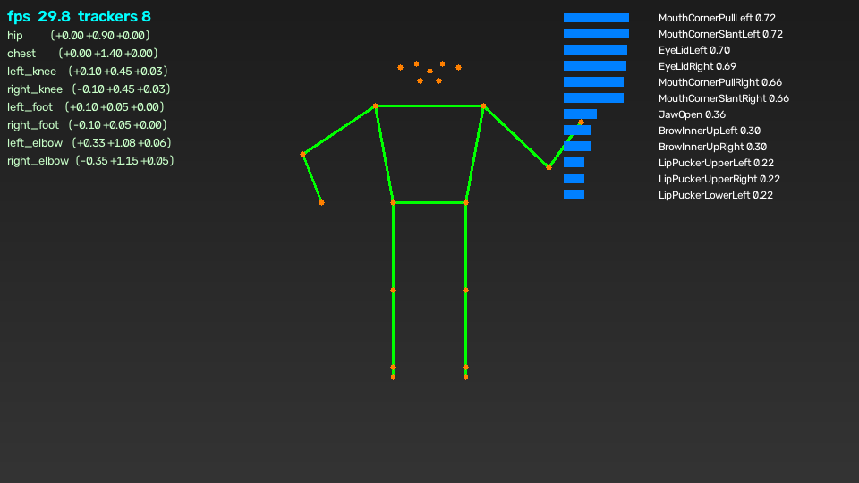
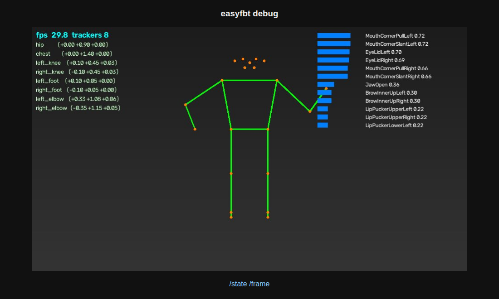

# easyfbt

**Webカメラだけで、VRのフルボディトラッキング(FBT)と表情トラッキングを。**

1台以上のWebカメラで全身の姿勢と表情を推定し、SteamVR/OpenVR の仮想トラッカーや
VRCFT (VRCFaceTracking) 方式の表情パラメータとして送出するツールです。
専用トラッカーもベースステーションも不要です。



## できること

| 機能 | 説明 |
|---|---|
| 🦴 姿勢トラッキング | MediaPipe Pose(33ランドマーク)から腰・胸・膝×2・足×2・肘×2 の最大8トラッカー(位置+回転)を生成 |
| 🙂 表情トラッキング | ARKit系 52 blendshapes を Unified Expressions に変換し、視線・まぶたも推定 |
| 🎥 マルチカメラ | 複数カメラをランドマーク単位の可視性で重み付け融合(オクルージョンに強い) |
| 🖥️ デバッグ画面 | スケルトン・表情バー・トラッカー座標・FPS をウィンドウまたはブラウザで確認 |
| 📤 出力4系統(併用可) | SteamVR(VMT) / VRChat OSCトラッカー / VRCFT方式OSC / UDP JSON |
| 🐳 コンテナ対応 | Docker/Podman で処理をまるごと隔離(Windows Defender 対策にも) |

## 動作要件

- Python 3.11 以上(または Docker / Podman)
- Webカメラ 1台以上(全身が映る位置に設置。腰から下が映らない場合は上半身のみ)
- 送出先: VRChat(OSC有効化)、または SteamVR + [VMT](https://github.com/gpsnmeajp/VirtualMotionTracker)

## クイックスタート

```bash
git clone https://github.com/sabas0ba/easyfbt && cd easyfbt

# 1) 仮想環境 + 依存関係(ハッシュ検証付き)
python -m venv .venv
source .venv/bin/activate          # Windows: .venv\Scripts\activate
pip install --require-hashes -r requirements/runtime.lock

# 2) MLモデルを取得(SHA-256検証・バージョン固定URL)
python tools/fetch_models.py

# 3) 設定を作って起動
cp config.example.toml config.toml
python -m easyfbt --config config.toml
```

起動するとデバッグウィンドウが開き、カメラ映像にスケルトンが重なれば姿勢トラッキングが、
右側にバーが動けば表情トラッキングが動作しています。終了は `q` キーまたは Ctrl-C。

```bash
python -m easyfbt --list-cameras   # カメラのデバイス番号を調べる
python -m easyfbt --no-window      # デバッグウィンドウなしで起動
```

## デバッグ画面の見方

上のスクリーンショットの各要素:

- **左上** — 処理FPSと現在出力中のトラッカー数。カメラFPS前後(30程度)が出ていれば正常です
- **左列** — 各トラッカーの部屋座標 `(X 右+ / Y 上+ / Z 、単位m)`。
  ランドマークの可視性が低い部位(画面外・遮蔽)は**リストから消えます**。誤った位置を送るより安全なためです
- **緑の線とオレンジの点** — 検出されたスケルトンとランドマーク
- **右列** — Unified Expressions 変換後の表情パラメータ上位12件

### ブラウザから見る(コンテナ・リモート向け)

`config.toml` で `[debug] http_enabled = true` にすると、同じ画面をブラウザで確認できます
(MJPEGストリーム)。コンテナ実行時はこちらが既定です。



- `http://127.0.0.1:8089/` — ライブプレビュー
- `/state` — トラッカー座標・表情の現在値JSON(スキーマは UDP JSON 出力と同一)
- `/frame` — 現在フレームのJPEG1枚

## VRChat で使う(SteamVR不要)

1. easyfbt 側: `[output.vrchat] enabled = true`(既定)と `[output.vrcft] enabled = true`(既定)
2. VRChat 側で OSC を有効化: アクションメニュー → **Options → OSC → Enabled**
3. easyfbt を起動し、カメラに全身が映っていることをデバッグ画面で確認
4. VRChat のアクションメニュー → **Tracking & IK → Calibrate FBT** でキャリブレーション
   (アバターの足元と自分の足の位置を合わせて Trigger)

- トラッカーは `/tracking/trackers/1..8`(腰=1、左右足=2/3、左右膝=4/5、胸=6、左右肘=7/8)として届きます
- 表情は `/avatar/parameters/v2/<UnifiedExpressions名>` の float を直接送ります。
  アバターに UE の float パラメータが必要です(VRCFT対応アバターの多くが該当)。
  VRCFT 本体のモジュール経由にしたい場合は `address_prefix` と `port` を受信側に合わせてください
  (バイナリパック化パラメータとアバターOSC設定のネゴシエーションは未対応)
- 視線は VRChat ネイティブの `/tracking/eye/CenterPitchYaw` でも送出(`send_eyes = true`)

## SteamVR で使う(VMT経由)

SteamVR に本物のトラッカーとして認識させたい場合(VRChat以外のVRアプリでも使えます):

1. [VMT (Virtual Motion Tracker)](https://github.com/gpsnmeajp/VirtualMotionTracker) を
   ダウンロードし、`vmt_manager` でドライバをインストール
2. `vmt_manager` の **Set RoomMatrix → Set from SteamVR** でルーム座標を設定
3. easyfbt 側: `[output.vmt] enabled = true` にして起動
4. SteamVR にトラッカー(VMT_1〜VMT_8)が現れるので、
   **設定 → コントローラー → Viveトラッカーの管理** でロール(腰・左足・右足など)を割り当て

## 複数カメラで精度を上げる

正面+側面など複数台を使うと、腕や脚が体で隠れるオクルージョンに強くなります。
`config.toml` に `[[camera]]` ブロックを追加し、各カメラの**部屋の中の位置と向き**を書きます:

```toml
[[camera]]            # 正面カメラ(+Z側から原点を見る)
device = 0
position = [0.0, 1.0, 2.0]
yaw_deg = 0.0
face = true

[[camera]]            # 右側面カメラ(+X側から原点を見る)
device = 1
position = [2.0, 1.0, 0.0]
yaw_deg = 90.0
face = false          # 表情は正面カメラのみで十分
```

`yaw_deg` はカメラの視線方向(0 = -Z向き、90 = -X向き)。各ランドマークは
「よく見えているカメラ」の重みが大きくなるよう自動で融合されます。

## Docker / Podman で動かす(コンテナ隔離)

トラッキング処理(カメラ入力→推論→OSC送出)をコンテナ内に閉じ込められます。
ホストと共有するのは最小限:**カメラデバイス(またはネットワークカメラURL)/
127.0.0.1限定のデバッグ用1ポート/ホストへのoutbound UDP(OSC)** のみです。
Windows Defender等にリアルタイム保護の例外を作る必要はなく、コンテナは
non-root・read-only rootfs・`cap_drop: ALL`・`no-new-privileges` で動作します。

```bash
docker compose up --build       # または podman-compose up --build
# デバッグ画面: http://127.0.0.1:8089/
```

- ベースイメージは**ダイジェスト固定**(`python:3.12-slim@sha256:646fb0…`、Docker公式イメージのAWSミラー。
  `--build-arg BASE_IMAGE=` で同一ダイジェストのままレジストリ差し替え可)。
  依存は `--require-hashes`、モデルはビルド時にSHA-256検証してイメージに焼き込み、実行時のダウンロードはありません
- OSC の宛先は `host.docker.internal`(Linuxエンジンでは compose の `host-gateway` 設定が解決)。
  outbound UDP なのでポート公開は不要です
- 設定を変えるには `config.container.toml` を編集して再ビルドするか、
  compose の volumes で `/config/config.toml` に自分の設定をマウントします

**Windows でのカメラ入力(2通り)**

1. **USBパススルー**: [usbipd-win](https://github.com/dorssel/usbipd-win) で
   `usbipd bind` → `usbipd attach --wsl` するとWSL2カーネルに `/dev/video0` が現れ、
   compose の `devices:` マッピングがそのまま使えます
2. **ネットワークカメラ(確実な代替)**: デバイスパススルーが難しい環境では、
   ホスト側でMJPEG配信(OBS の VirtualCam + 配信プラグイン、スマホのIPカメラアプリ等)し、
   `config.container.toml` の `device` を `"http://host.docker.internal:8080/video"` のような
   URLに変えるだけで動きます(`devices:` と `group_add:` は削除可)

## UDP JSON データインターフェース

`[output.udp_json] enabled = true` で、自作ツールやロガーから使える生データが
1フレーム=1データグラムで届きます:

```json
{"v": 1, "t": 12.5, "fps": 29.7,
 "trackers": [{"role": "hip", "index": 1, "pos": [0.0, 0.9, 0.0], "rot": [0.0, 0.0, 0.0, 1.0]}],
 "expressions": {"JawOpen": 0.12},
 "eyes": {"pitch": 0.0, "yaw": 0.0}}
```

`pos` は部屋空間(右手系, +Y上, m)、`rot` はクォータニオン `[x, y, z, w]` です。

## 設定リファレンス

`config.example.toml` に全項目のコメント付き実例があります。主な項目:

| キー | 既定値 | 説明 |
|---|---|---|
| `tracking.target_fps` | `30.0` | 処理ループの目標FPS |
| `tracking.user_height` | `1.70` | 身長(m)。腰アンカーの高さを決める |
| `tracking.smoothing_min_cutoff` | `1.0` | One Euroフィルタ。**下げると**静止時の震えが減る |
| `tracking.smoothing_beta` | `0.02` | One Euroフィルタ。**上げると**速い動きの遅延が減る |
| `tracking.min_visibility` | `0.5` | これ未満の可視性の部位はトラッカーを出さない |
| `tracking.roles` | 腰・両足・両膝・胸 | 出力するトラッカー。両肘は `"left_elbow"` 等を追加 |
| `camera.device` | `0` | デバイス番号、またはストリームURL文字列 |
| `camera.position` / `yaw_deg` | `[0,1,2]` / `0` | カメラの部屋内位置(m)と視線方向(度) |
| `camera.pose` / `face` | `true` | このカメラを姿勢/表情推定に使うか |
| `output.vmt.*` | 無効, `127.0.0.1:39570` | SteamVR(VMTドライバ)出力 |
| `output.vrchat.*` | 有効, `127.0.0.1:9000` | VRChat OSCトラッカー出力 |
| `output.vrcft.*` | 有効, `127.0.0.1:9000` | 表情(UE)出力。`address_prefix` で宛先形式を変更 |
| `output.udp_json.*` | 無効, `127.0.0.1:9199` | 汎用JSON出力 |
| `debug.window` | `true` | OpenCVデバッグウィンドウ |
| `debug.http_enabled` / `http_port` | `false` / `8089` | ブラウザデバッグビュー |

## トラブルシューティング

| 症状 | 対処 |
|---|---|
| カメラが開けない | `--list-cameras` で番号確認。他アプリ(OBS等)がカメラを掴んでいないか確認 |
| スケルトンが出ない | 全身(最低でも腰から上)がフレームに入るようカメラを引く。部屋を明るく |
| 足のトラッカーが出ない | 仕様です:足が映っていない/可視性が低いと出力しません。カメラ位置を調整 |
| VRChatで反応しない | VRChat の OSC が Enabled か、ポート9000を他ツール(VRCFT等)が専有していないか確認 |
| 動きが左右反転する | `camera.yaw_deg` を 180 変える、またはカメラアプリ側のミラーリングを切る |
| 震える / 遅延する | 震え→ `smoothing_min_cutoff` を下げる。遅延→ `smoothing_beta` を上げる |
| 表情が動かない | アバターが UE float パラメータ対応か確認。非対応なら VRCFT 経由にする |
| FPSが低い | カメラ解像度を 1280x720 → 640x480 に下げる。複数カメラなら台数を減らして切り分け |
| コンテナでカメラ不可 | usbipd-win の attach を確認。ダメならネットワークカメラURL方式へ |

## アーキテクチャ(開発者向け)

```
カメラ(スレッド) ──> 最新フレーム ──> Pose/Face バックエンド (MediaPipe Tasks)
      │ (台数分)                          │
      └──────────────> 部屋座標系へ変換 ──> マルチカメラ融合 (可視性重み付け)
                                           │
                            One Euro フィルタで平滑化
                                           │
              ┌────────────────────────────┼───────────────────────┐
        スケルトン→トラッカー変換    ARKit→Unified Expressions   デバッグ画面
              │                            │
      VMT / VRChat OSC 出力         VRCFT 方式 OSC 出力        UDP JSON 出力
```

- 座標系: 部屋空間は SteamVR 準拠(右手系・+Y上・メートル)。VMT/VRChat 送出時に Unity 左手系へ変換
- v0.1 では腰位置を `user_height * 0.53` の高さに固定アンカーします(単眼カメラでは絶対深度が
  取れないため)。VRChat / VMT 側のキャリブレーションで吸収されます
- 重い CV 依存(mediapipe / opencv)は `backends/` と `capture.py` に隔離してあり、
  コアロジックは numpy と標準ライブラリのみで動作・テストできます(OSC エンコーダも自前実装)

## 開発・テスト

```bash
pip install --require-hashes -r requirements/ci.lock
python -m pytest --cov          # 純ロジック単体テスト + ループバックUDP統合テスト
ruff check . && ruff format --check .
```

- フレームソース・バックエンド・出力・クロックをすべて注入可能にしてあり、
  カメラや mediapipe なしで全パイプラインをテストできます(`tests/test_app_integration.py`)
- OSC はゴールデンバイト列とデコーダで検証、Unity 座標変換・オイラー角は往復テストで検証
- CI (GitHub Actions) は lint + Python 3.11/3.12 マトリクス + 実モデル e2e + Docker ビルドを実行し、
  カバレッジ 85% 未満で失敗します

### ゴールデンサンプルテスト

台本化した決定論的なセッション(体のヨー回転+腕上げ+表情変化、固定クロック)を実パイプラインに流し、
**4出力すべての全パケット**(VMT / VRChat / VRCFT の OSC をデコードしたもの + UDP JSON)を
`tests/golden/scripted_session.json` と照合します。出力仕様を意図的に変えた場合は:

```bash
pytest tests/test_golden_outputs.py --update-goldens   # ゴールデンを再生成して差分をレビュー
```

### e2e テスト(実モデル・実画像)

実際の MediaPipe モデルとハッシュ検証済みのテスト画像で、システムとしての機能性を検証します:

```bash
pip install --require-hashes -r requirements/runtime.lock
python tools/fetch_models.py        # モデル(SHA-256 検証)
python tools/fetch_test_assets.py   # テスト画像(SHA-256 検証)
pytest -m e2e                       # 通常の pytest 実行からは除外されています
```

検証内容: 笑顔のポートレートから `MouthCornerPull* > 0.5` 等のもっともらしい表情パラメータが出ること、
上半身のみの画像で脚のトラッカーが可視性ゲーティングで正しく除外されること(hip/chest/肘のみ出力)、
OSC パケットの整形式性、および最終フレームの UDP JSON を許容誤差付きゴールデン
`tests/e2e/golden/portrait_session.json` と照合(モデル推論は CPU により微差が出るため tol=0.05)。
再生成は `pytest -m e2e --update-goldens`。

## セキュリティ / サプライチェーン

- **依存関係は最小限**: 実行時は `mediapipe` / `opencv-python` / `numpy` のみ(OSC・設定・UDP は標準ライブラリで自前実装)。開発用も `pytest` / `pytest-cov` / `ruff` のみ。
- **SHA ピン留めを必須化**:
  - Python 依存は `requirements/*.lock` に全配布ファイルの SHA-256 を記録し、`pip --require-hashes` でのみインストール(ロックは `tools/gen_lock.py` で再生成)
  - GitHub Actions は**フルコミットSHA**でピン留め(Dependabot が SHA ごと更新)
  - コンテナのベースイメージは**ダイジェスト固定**
  - ML モデルはバージョン固定 URL + SHA-256 検証付きダウンロード(`tools/fetch_models.py`)。実行時の暗黙ダウンロードなし
- CI の `GITHUB_TOKEN` は `contents: read` のみ、checkout は `persist-credentials: false`
- ネットワーク送信は既定で `127.0.0.1` 宛の UDP のみ

## 既知の制限 / ロードマップ

- ルームスケール移動(体全体の平行移動)は未推定(腰アンカー固定)
- マルチカメラは向きの融合のみで、外部パラメータの自動キャリブレーションは未実装
- VRCFT のバイナリパックパラメータ / アバターOSC設定ネゴシエーションは未対応
- 手指トラッキングは未対応

## ライセンス

[Apache License 2.0](LICENSE)

READMEのスクリーンショットは実際の描画コードで生成した合成データです(`docs/images/`)。
